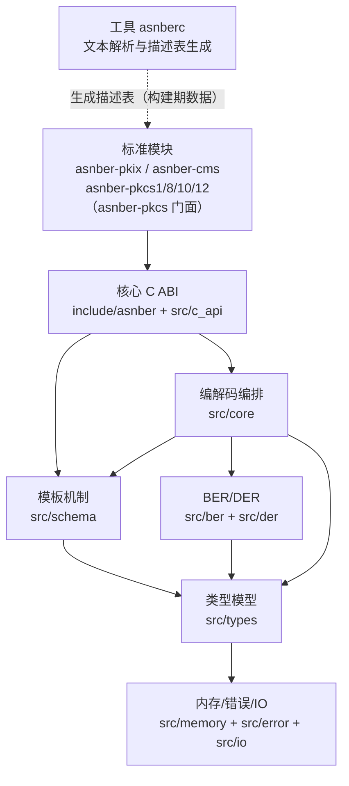
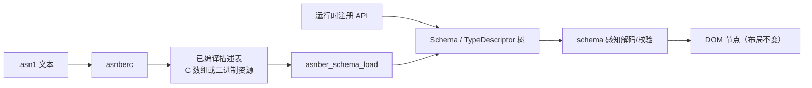

# 总体架构

## 1. 目标与约束

`asnber` 是通用 ASN.1 编解码库：外部只通过 C ABI 调用，内部用 C++ 实现。标准结构（X.509/PKIX、CMS、PKCS）不以核心内置代码实现，而以依赖核心的独立模块提供。

架构必须同时满足：

- **核心零领域知识**：核心库不得出现 X.509、PKIX、CMS、PKCS、证书、密钥、签名算法等领域概念，不得内置标准结构表。
- **模板机制在核心**：核心接受已编译好的类型描述表，构建类型树，用于字段命名、约束校验与 `CHOICE`/`SET OF`/`OPTIONAL`/`DEFAULT` 判定。
- **单向依赖**：模块 → 核心；核心不得反向引用模块。工具独立于核心 ABI。
- **跨平台**：Windows、Linux、macOS 可构建；嵌入式可裁剪到无异常、无 RTTI、受限堆或静态分配。
- **ABI 边界干净**：公共头文件仅 C99 语法，不出现 `namespace`、模板、引用、类、异常、`std::` 类型。
- **失败可控**：所有公开操作返回错误码，不使用异常跨越 ABI；失败路径不留半成品对象。
- **可验收**：一期核心模板机制 + `asnberc` MVP + `asnber-pkix` 必须能解析真实 X.509 证书并取到 subject/issuer/validity/extensions。

## 2. 分层与依赖方向



实线表示链接依赖，虚线表示构建期数据流。工具不链接核心，核心不引用工具；模块只依赖核心 ABI。构造侧的领域无关设施收敛到不安装、不导出的 header-only 共享层 `modules/common/src/detail/`（`asnber::module_support`，ADR-0014 已恢复），各包只在内部使用、对外仅导出薄封装；它不引入模块之间的链接依赖。

| 层 | 职责 | 允许依赖 | 禁止事项 |
| --- | --- | --- | --- |
| 标准模块层 | 提供标准结构的描述表与模块专用 C API | 核心 ABI | 反向依赖核心内部头文件、把领域词塞入核心、跨模块包含内部头 |
| 工具层 | 解析 `.asn1` 文本、语义校验、生成描述表 | 无核心运行时依赖 | 进入核心 ABI、被核心链接 |
| C ABI 层 | 参数校验、句柄封送、错误码转译、输出适配 | 模板机制、编排层、基础设施 | 解析 TLV、持有 C++ 类型、出现领域概念 |
| 模板机制层 | 描述表加载、运行时注册、类型树、字段名与约束校验 | 模型层、基础设施 | 解析 `.asn1` 文本、持有可变全局注册表 |
| 编解码编排层 | 一次解码/编码、runtime 构树、资源预算、reader/writer 适配 | 规则层、模型层、模板机制、基础设施 | 直接解释领域语义、暴露内部类型 |
| 编码规则层 | BER/DER 标签、长度、内容读写与合法性/规范化检查 | 模型层、基础设施 | 决定 C API 形态、执行全局资源策略 |
| 类型模型层 | 标签、节点、文档、值视图、模式绑定 | 基础设施 | 直接做字节 IO、依赖具体编码规则 |
| 基础设施层 | 分配器、arena、静态池、错误上下文、字节缓冲 | 标准库最小子集 | 依赖上层类型、异常/RTTI、可变全局状态 |

## 3. 仓库与模块划分

```text
CMakeLists.txt            根，编排核心、模块与工具
include/asnber/             核心公共 C ABI
src/                      核心实现
modules/pkix/             asnber-pkix：include + src + 独立导出包
modules/cms/              asnber-cms
modules/pkcs1/            asnber-pkcs1（PKCS#1，读 + 公/私钥构造）
modules/pkcs8/            asnber-pkcs8（PKCS#8，读 + PrivateKeyInfo 构造）
modules/pkcs10/           asnber-pkcs10（PKCS#10，读 + CertificationRequest 构造）
modules/pkcs12/           asnber-pkcs12（PKCS#12，只读）
modules/pkcs/             asnber-pkcs 聚合包（INTERFACE：仅聚合头，不产库）
tools/asnberc/              独立工具（MVP 已落地）
```

| 路径 | 模块 | 主要内容 | 阶段 |
| --- | --- | --- | --- |
| `include/asnber/` | 核心公共头 | 版本、错误、分配器、解码、编码、节点、模板 | 一期 |
| `src/c_api/` | C ABI 适配 | `extern "C"` 入口、句柄转换、`struct_size` 校验 | 一期 |
| `src/schema/` | 模板机制 | 描述表加载、运行时注册、类型树、约束校验 | 一期 |
| `src/core/` | 编排 | `Context`、`Document` 生命周期、预算、IO 适配 | 一期 |
| `src/types/` | 模型 | `Tag`、`Node`、`Document`、值视图、模式绑定 | 一期 |
| `src/ber/` | BER | 标签、长度（含不定长）、TLV 游标 | 一期 |
| `src/der/` | DER | 严格校验、规范化输出、SET/SET OF 排序 | 一期 |
| `src/memory/` | 内存 | 分配器 vtable、arena、静态池、预算记账 | 一期 |
| `src/error/` | 错误 | 错误码、错误上下文、消息生成 | 一期 |
| `src/io/` | IO | 内存切片、reader/writer 回调包装 | 一期 |
| `modules/pkix/` | `asnber-pkix` | RFC 5912 描述表 + X.509 字段访问与证书构造 C API | 一期 |
| `modules/pkcs1/` | `asnber-pkcs1` | RFC 8017 附录 A 描述表 + RSAPublicKey/RSAPrivateKey 只读 C API 与 builder | 二期第一批 |
| `modules/pkcs8/` | `asnber-pkcs8` | RFC 5208 描述表 + PrivateKeyInfo/EncryptedPrivateKeyInfo 只读 C API 与 PrivateKeyInfo builder | 二期第一批 |
| `modules/pkcs10/` | `asnber-pkcs10` | RFC 2986 描述表 + CertificationRequest 只读 C API 与 builder | 二期第一批 |
| `modules/pkcs12/` | `asnber-pkcs12` | RFC 7292 描述表 + PFX/SafeContents/CertBag 只读 C API 与 PFX/AuthenticatedSafe builder | 二期第一批 |
| `modules/pkcs/` | `asnber-pkcs` | 聚合包：不产库、不导符号，只聚合四包公共头并以 INTERFACE 依赖传递 | 二期第一批 |
| `modules/cms/` | `asnber-cms` | RFC 6268 描述表 + 模块 C API（只读） | 二期第二批 |
| `tools/asnberc/` | `asnberc` | `.asn1` 解析、语义校验、描述表生成 | 一期 MVP / 二期完善 |
| `tests/` | 测试 | 单元、一致性、模块、模糊、内存检查 | 一期起 |
| `examples/` | 示例 | C 与 C++ 消费方式 | 一期 |

- 核心 C++ 命名空间 `asnber`；模块命名空间 `asnber::pkix`、`asnber::cms`、`asnber::pkcs1`、`asnber::pkcs8`、`asnber::pkcs10`、`asnber::pkcs12`；聚合包 `asnber::pkcs`（INTERFACE 目标）。
- 模块公共头位于 `modules/<name>/include/asnber/<name>/`，不并入核心伞头 `asnber/asnber.h`。
- 模块符号前缀 `asnber_pkix_`、`asnber_cms_`、`asnber_pkcs_`；核心符号保持 `asnber_`。
- **PKCS 符号命名（0.4.0 起）**：PKCS#1/#8/#10 的函数沿用 `asnber_pkcs_*`（31/22/25），PKCS#12 沿用 `asnber_pkcs12_*`（37）；聚合包不导符号。包拆分不改变函数名，调用方无需改代码；仓库中仍然不存在 `asnber_pkcs1_*`、`asnber_pkcs8_*`、`asnber_pkcs10_*` 三组函数前缀（见 [ADR-0015](adr/0015-PKCS按标准拆分模块.md)）。

## 4. 模板机制

核心只消费已编译描述表，不在运行时解析 `.asn1` 文本：



- **两条入口等价**：描述表加载与运行时注册都构建同一棵类型树，不出现两套字段命名或约束语义。
- **描述表格式**：带 `format_version` 的已编译数据，包含模块默认标注方式、字符串池、类型表、字段表、约束表与默认值表；布局固定为 `uint8_t[]` 显式小端读取，不依赖 C 结构体布局。唯一契约见[描述表格式](11-描述表格式.md)。
- **模板模型**：类型构造性由 `kind` 派生，标签行为由 `tag_mode` 与模块默认标注方式决定；约束挂在类型上并可多条；`DEFAULT` 以规范 DER TLV 存放。
- **文本解析边界**：只有 `asnberc` 解析 `.asn1` 文本；核心不链接工具，也不包含词法器/语法器。
- **一期 `asnberc` 能力**：支持基本/构造类型、标注方式、约束、扩展标记；输入支持自包含展平模块与多模块 `IMPORTS`（合并为一张描述表），并支持单类型参数化定义与实例化（值参数与多参数报 9006）；`CLASS`/`WITH SYNTAX`/信息对象集通过预展开模块输入，展平等价性由 CI 校验；参数化直接展开原始 RFC 模块留后续。
- **模块描述表**：由 `asnberc` 从公开 RFC 模块生成，随模块发布，不手写第二份结构定义。

## 5. 核心数据流

### 5.1 解码

1. C ABI 校验参数、`struct_size` 与 `asnber_decode_options_t`。
2. 编排层创建 `Document`，建立 arena 与资源预算（深度、节点数、输入字节）；`options.max_depth` 只能在上下文默认值基础上收紧。
3. 输入适配：`asnber_decode_buffer` 默认零拷贝、`ASNBER_DECODE_COPY_INPUT` 时复制；`asnber_decode_reader` 通过回调取字节。
4. BER 层递归解析标签与长度，模型层生成节点；DER 解码执行严格规则检查。
5. 若提供 schema，模板层按类型树绑定字段名并执行结构/约束校验；否则走通用 DOM。未知字段按解码选项保留/告警/拒绝。
6. 成功后返回 `asnber_doc_t*` 与实际消费字节数 `consumed`；失败销毁 arena 并返回错误码，不返回部分结果。

### 5.2 编码

runtime 构树与解码结果共用同一文档模型；封存后编码路径不区分来源。

1. C ABI 校验 `asnber_encode_options_t`（基线仅 `ASNBER_ENCODING_DER`）与可选 schema。
2. 编排层遍历节点树，向 DER 层请求规范化 TLV 输出；启用 schema 时执行 DEFAULT 省略、字段顺序与 `SET OF` 排序。
3. DER 层执行确定长度、基本类型规范化、SET/SET OF 排序，通过 writer 或内部缓冲输出。
4. 输出缓冲由上下文分配，调用方通过 `asnber_buf_release` 归还；未归还时由 `asnber_ctx_destroy` 回收。

无 schema 时只能应用通用规范化规则，无法还原 `DEFAULT` 省略语义；启用 schema 后可依据类型树恢复。writer 必须满足“全写或返回错误”契约，库不做部分写入回滚。

### 5.3 模块高层接口

`asnber-pkix` 等模块在核心 schema 感知 DOM 之上提供领域字段访问，例如证书的 subject/issuer/validity/extensions；构造侧按调用方给值组装节点并输出 DER。模块只保存借用节点指针，不复制节点、不二次解析字节、不改变核心布局；领域逻辑全部留在模块内。

第一版标准模块只做结构读写（构造侧只按调用方给值组装 DER），不承担密码学语义：`asnber-pkcs1/8/10/12` 不解密、不做口令派生与 PKCS#12 MAC 校验、不做 RSA 运算/填充/签名/加密；`asnber-cms` 不验签、不摘要、不解密、不校验证书链；`asnber-pkix` 不签名、不验签、不解释扩展语义。实现包之间不互相依赖，`asnber-pkcs` 聚合包只向下依赖四个实现包；CMS 需要的 PKIX 类型在其自身展平模块中复制（见 [ADR-0012](adr/0012-标准模块路线与只读边界.md)、[ADR-0015](adr/0015-PKCS按标准拆分模块.md)）。

## 6. 横向切面与不变量

- **内存**：所有分配通过上下文分配器进入上下文级对象或文档 arena；节点不支持单点释放；静态池模式不回退到堆。
- **错误**：内部返回状态对象或错误码，不使用异常；错误上下文只在上下文层写入。
- **资源上限**：深度、节点数、输入/输出字节与告警记录数在入口统一记账，规则层不得绕过。
- **线程**：上下文不是线程安全；解码后的文档与节点只读，可并发读取；无全局可变状态。
- **核心零领域词**：核心公共头、源码、测试夹具不得出现 X.509/PKIX/CMS/PKCS/证书/密钥/签名算法等标识；由 CI 静态检查拦截。
- **不变量**：
  1. 公共头文件可被 C99 单独包含，不引入 C++ 符号。
  2. 公开函数不抛出 C++ 异常，错误通过 `asnber_err_t` 返回。
  3. 失败时输出句柄为 `NULL`，不返回部分文档。
  4. 节点指针是借用引用，不超过所属文档生命周期。
  5. 解析器对输入有界读取，长度/偏移计算做溢出检查。
  6. 不依赖宿主字节序；多字节整数与长度按大端处理。
  7. 核心不依赖任何模块；模块不包含核心内部头文件。
