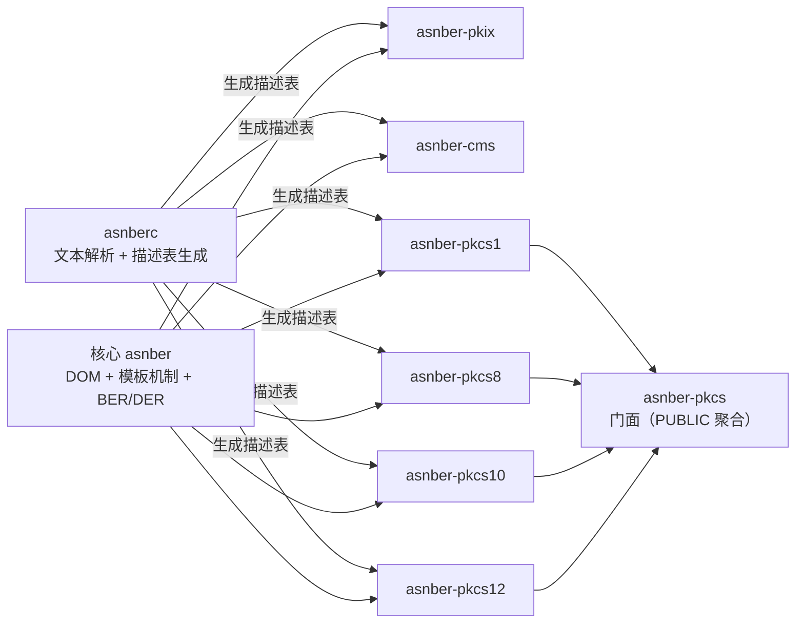

# 里程碑与分期

本文件定义从文档基线到可用版本的阶段划分、依赖关系与验收标准。只使用单一分期设定，不引入编号式多版本。

## 1. 当前状态

| 阶段 | 内容 | 状态 |
| --- | --- | --- |
| M0 | 文档基线、ADR、目录与构建骨架 | 已完成 |
| M1 | 核心骨架与多包构建可配置、可构建 | 已完成 |
| 一期 | 核心 DOM、模板机制、`asnberc` MVP、`asnber-pkix` | 已完成 |
| 二期第一批 | PKCS 只读结构访问（PKCS#1/#8、PKCS#10 与 PKCS#12 已落地；按标准拆为 `asnber-pkcs1/8/10/12` 四包，`asnber-pkcs` 退化为不产库的聚合包；#8/#1/#10/#12 与 PKIX 证书构造已补） | 已完成（只读切片 + #1/#8/#10/#12 与 PKIX 构造） |
| 二期第二批 | `asnber-cms` 只读结构访问 + `ContentInfo`/`SignedData`/`EnvelopedData`/`EncryptedData`/`CompressedData`/`AuthenticatedData` 结构构造（写；六个顶层容器已覆盖） | 已完成。`AuthenticatedData`、`EnvelopedData` 的 `OtherRecipientInfo`、`EncryptedData` version 2 的 `unprotectedAttrs` 没有外部生产方样本，这三处验证停在构造级 |
| 发布 | `v0.1.0` 为首个版本，包含当前核心、`asnberc` 与 PKIX/CMS/PKCS 模块 | 2026-11-11 |

一期当前拆解：

- 已完成：上下文/内存模型（含静态池与兜底回收边界）、错误模型与上下文级错误详情、DOM 值树（文档/节点创建与封存、只读访问）、值读取（BOOLEAN、INTEGER、ENUMERATED、OCTET STRING、BIT STRING、OID、UTF-8 字符串、大整数、时间）、schema 模板骨架（运行时注册与描述表加载共用类型树、结构/约束合法性校验、封存检查）、BER `consumed` 与多字节 tag number、BER 不定长（单层/嵌套/EOC、`tlv_size` 含 EOC、构造内容合并）、DER 严格解码校验、DER 编码器（缓冲与 writer 两种输出、`max_output_bytes` 预算）、ANY 的 schema 注册/描述表 `kind = 6`/无包装与 `EXPLICIT` 包装节点语义/编码回写、`SEQUENCE` 中 DEFAULT ANY 末位与 `SET` 禁止规则、`SET OF ANY`、schema 感知解码（buffer/reader 两条路径）、约束求值（RANGE/SIZE/ENUM/MAX/BIGINT）、`asnber_doc_validate`、schema 感知编码（DEFAULT 省略、字段顺序、SET/SET OF 排序、EXPLICIT ANY 重包装、SEQUENCE 未知字段保留、SET 未知字段拒绝、ANY/保留 TLV 的 DER 一致性校验）与 `ASNBER_CAP_ANY_OPEN_TYPE` 置位、`asnber_decode_reader`（分段拉取、`consumed`、IO 回调包装）、`asnberc` MVP（词法/语法解析、语义校验、描述表 1.0 生成、C 数组与二进制两种产物、CRC32C、确定性可复现、CLI 与诊断格式）、描述表名称表（BIT 命名位 / 数值名，`header_size = 108`）、`asnber-pkix` 模块（检入描述表、证书打开/关闭、路径查找、常用字段访问器、独立 `find_package` 消费；P5 增加 `Certificate`/`TBSCertificate` 构造；`CertificateList` 结构读写含 CRL 扩展与条目扩展）。
- 进行中：无。
- 二期任务：参数化类型展开（B 期已交付单类型参数，值参数与多参数留后续）；模糊测试与差分测试已落地，见[测试与验证](07-测试与验证.md)。
- 分期说明：`asnberc` 已支持多模块 `IMPORTS`（单表合并）与单类型参数化展开；值参数化、多参数参数化、`CLASS`/`WITH SYNTAX`/信息对象集直接解析仍报 9006，留后续。

一期后续子阶段（DER 严格模式，已落地）：最短长度编码、BOOLEAN 仅接受 `0x00`/`0xFF`、INTEGER/ENUMERATED 无冗余前导字节、构造字符串禁止、SET/SET OF 排序、时间规范化（必填秒、DER 只接受 `Z`、无冗余小数尾零）、OID 最短 base128；违反返回 `ASNBER_E_NON_CANONICAL`，不定长与 EOC 返回 `ASNBER_E_INDEFINITE_NOT_ALLOWED`。`ASNBER_ENCODING_DER` 现已按上述规则严格解码。

编码阶段子项：DER 输出规范化与 SET/SET OF 排序已落地；schema 感知编码已落地，按 schema 省略 DEFAULT、按字段顺序输出、重排 SET/SET OF 并重新包装 EXPLICIT ANY；描述表默认值仍只做结构级规范校验，见[描述表格式](11-描述表格式.md)第 7 节。

## 2. 依赖关系

- 核心不依赖任何模块或工具。
- 模块只依赖核心；模块之间不互相依赖。`asnber-cms` 需要的 PKIX 类型在 CMS 自己的展平模块中复制，不新增 `asnber-cms → asnber-pkix` 依赖（见 [ADR-0012](adr/0012-标准模块路线与只读边界.md)）。
- 唯一的包间关系是门面：`asnber-pkcs` 不带描述表与实现源码，只保留版本符号，并以 PUBLIC 链接聚合 `asnber-pkcs1/8/10/12`；四个实现包之间互不依赖，也不依赖 PKIX 或 CMS（见 [ADR-0015](adr/0015-PKCS按标准拆分模块.md)）。
- 模块构造侧的领域无关设施位于 `modules/common/src/detail/module_builder_support.h`，经 INTERFACE 目标 `asnber::module_support` 供各模块私有复用，CMS 与 `asnber-pkcs8` 为首批消费者；它不是安装包、不导出符号，也不构成模块之间的链接依赖（[ADR-0014](adr/0014-模块共享构造支撑.md)，P1 起已恢复）。
- 工具在构建期生成描述表，不作为模块的运行时依赖。

## 3. 一期范围

### 3.1 硬前置任务：产出 PKIX 展平模块

| 项 | 内容 |
| --- | --- |
| 任务定位 | `asnberc` 端到端验收与 `asnber-pkix` 描述表生成的**硬前置**；未完成时一期验收不能通过 |
| 输入来源 | RFC 5912 的 `PKIX1Explicit-2009`、`PKIX1Implicit-2009`、`PKIX-CommonTypes-2009`；原版文本放入 `modules/pkix/asn1/reference/rfc5912/`，只作参考 |
| 产出形态 | `modules/pkix/asn1/` 下的展平 `.asn1` 纯文本；允许合并为自包含单文件（当前为 `PKIX-Flattened-2009.asn1`），不得包含 `CLASS`、`WITH SYNTAX` 或信息对象集；不做任何标签/约束/顺序改动 |
| 验收方式 | 与 RFC 5912 原版**类型集合一一对账**：类型名、字段顺序、`OPTIONAL`/`DEFAULT`/扩展位置、有效标签、约束、抽样 DER 编码等价、可复现，规则见[描述表格式](11-描述表格式.md)第 14.2 节 |
| 当前状态 | 已产出 `modules/pkix/asn1/PKIX-Flattened-2009.asn1`；类型集合对账表见同目录 `reconciliation.md`，8 条 Verified 勘误不改变保留类型 |

该任务必须显式排入一期执行序列，不得以注释或“后续再说”的方式隐藏；其完成时间直接决定 `asnberc` 能否开始端到端验收，也决定 `asnber-pkix` 能否生成描述表。

### 3.2 交付内容

- 核心 C ABI：文档、节点、编解码、错误、内存、告警、模板注册/加载。
- BER 解码（含不定长）与 DER 解码/编码；解码选项、`consumed`、告警载体。
- 通用 DOM 与 runtime 构树。
- 模板机制：已编译描述表加载 + 运行时注册，构建同一类型树；类型种类/标注方式、字段命名、结构/约束校验、`CHOICE` 分支、`SEQUENCE OF`/`SET OF`、`OPTIONAL`、`DEFAULT`（规范 DER TLV）与扩展标记判定。
- 描述表格式冻结：`uint8_t[]` 显式小端读取、版本兼容、越界校验与展平等价性检查，见[描述表格式](11-描述表格式.md)。
- 核心值类型能力：大整数只读视图与严格十进制导出、BIT STRING 位级读取、字符串白名单 UTF-8 转换、UTCTime/GeneralizedTime 结构化只读解析（含纳秒与时区偏移）、OID 点分文本。
- `asnberc` MVP：解析 `.asn1` 文本（单模块展平输入或多模块 `IMPORTS` 输入）、基础语义校验、生成 C 数组或二进制描述表（含名称表）；诊断格式与错误码冻结；支持单类型参数化定义与实例化（`Foo { Type }` / `Foo { INTEGER }`），语义阶段把形参替换为实参后生成等价描述表；值参数化、多参数参数化、`CLASS`/`WITH SYNTAX`/信息对象集仍报 9006。
- `CLASS`/`WITH SYNTAX`/信息对象集：一期以预展开模块作为输入，原版模块保留作参考，CI 校验类型集合逐一对应。
- `asnber-pkix`：RFC 5912 描述表 + 证书字段访问 C API，作为模板机制首个消费者。
- 测试、示例、CI 与内存检查基线。

### 3.3 验收标准

1. **通用编解码**：BER 不定长、DER 严格模式、DER 输出规范化、SET/SET OF 排序通过规范用例与差分测试。
2. **模板等价性**：同一份 PKIX 描述，分别用描述表加载与运行时注册构建类型树，字段名、约束结果、解码结构完全一致。
3. **描述表生成**：`asnberc` 能从 RFC 5912 展平模块生成描述表；生成过程可复现，C 数组与二进制逐字节同布局；CI 校验生成产物与工具输出一致，并校验展平模块与原版类型集合逐一对应。
4. **证书解析**：`asnber-pkix` 能解析真实 X.509 证书，取到 subject、issuer、validity、extensions；未知扩展保留原始 TLV。（已验收：RSA 自签、RSA-PSS、EC 自签三张证书；`algorithmIdentifier.parameters` 的 NULL/内层 SEQUENCE/缺省三种形态均以原始 TLV 返回，`child_count = 0`。）
5. **约束校验**：PKIX 描述表中的字段顺序、必选/可选、`CHOICE`、SIZE/值域/枚举/大整数约束能返回明确错误；扩展标记影响未知字段处理；不实现签名/链/有效期校验。
6. **值类型**：证书中的大整数可导出严格十进制文本；BIT STRING 可读取位长与未使用位数；白名单字符串可转 UTF-8；UTCTime/GeneralizedTime 可结构化读取，纳秒与时区偏移保留。
7. **ABI 与边界**：C99 可包含；C/C++ 示例可运行；核心源码与公共头不出现领域词，CI 静态检查通过。
8. **重建与移植**：共享/静态、仅静态、freestanding 子集、安装与 `find_package(asnber CONFIG)` 消费通过；`find_package(asnber-pkix CONFIG)` 的共享与静态两种链接独立消费工程均构建并运行通过。
9. **测试**：doctest 单元测试、ASan/UBSan、libFuzzer 种子回归、至少一组外部实现差分测试通过。

### 3.4 模块描述表生成方式

- `asnber-pkix` 的描述表由 `asnberc` 从 RFC 5912 的**展平模块**生成，而不是手写维护；核心不携带任何标准结构表。
- 展平模块与原版模块的关系、来源、勘误与等价性校验见[描述表格式](11-描述表格式.md)第 14、15 节；原版模块只作参考，不参与构建。
- 生成产物已检入 `modules/pkix/generated/`（`pkix_schema.h` 与 `pkix_schema.bin`），保证没有 `asnberc` 的环境也能构建；`-DASNBER_PKIX_REGENERATE_TABLE=ON` 时构建期重新生成并逐字节比对，差异即构建失败。
- 模块发布包携带生成后的描述表，宿主无需安装 `asnberc` 即可使用。
- 既有模块仍使用自包含展平模块输入；`asnberc` 同时支持多模块 `IMPORTS` 输入并合并为一张描述表。直接消费原始 RFC 模块（`CLASS`/信息对象集）仍列为二期任务，见第 4 节。

## 4. 二期范围

| 内容 | 验收标准 |
| --- | --- |
| PKCS 四包（第一批，先做；`asnber-pkcs` 为门面） | 基于自包含展平模块与检入描述表，`asnber-pkcs1/8/10/12` 只读解析 PKCS#1/#8、PKCS#10 与 PKCS#12 样例；四包可独立安装/链接，每张描述表独占一个翻译单元。不解密、不做 RSA 运算、不验签、不校验 MAC；`ANY` 只返回原始 TLV |
| `asnber-cms`（第二批，后做） | 基于 RFC 6268 自包含展平模块解析 `ContentInfo`/`SignedData`/`EnvelopedData`/`EncryptedData` 样例，并可用 builder 按结构组装、输出 DER；PKIX 类型在 CMS 模块内复制，不依赖 `asnber-pkix`；不验签、不摘要、不解密、不校验证书链；构造侧不生成签名/摘要、不推导版本（`EncryptedData` 的 0/2 版本配对除外） |
| 模板增强 | 提供增量/分步校验；错误定位到字段路径；评估直接解析 `CLASS`/`WITH SYNTAX`/信息对象集 |
| `asnberc` 完善 | 完整语义校验、稳定输出格式、可重复构建与版本化描述表；评估值参数化与多参数参数化 |
| 参数化展开（B 期已交付） | 单类型参数化定义（`Foo { Type }`）与实例化（`Foo { INTEGER }`）已支持，语义阶段把形参替换为实参、生成与人工展平逐字节一致的描述表；参数化实例化错误用 9008；值参数与多参数留后续 |
| 增量 feed（B 期已交付） | `asnber_decoder_create` / `asnber_decoder_feed` / `asnber_decoder_finalize` push 模式入口，分块推送、finalize 构建 DOM；与 `asnber_decode_buffer` 解码行为一致 |

### 4.1 二期执行顺序与切片

顺序固定为 `asnber-pkcs` 先、`asnber-cms` 后（[ADR-0012](adr/0012-标准模块路线与只读边界.md)）：

| 顺序 | 切片 | 状态 | 边界 |
| --- | --- | --- | --- |
| 1 | PKCS#1（RFC 8017）+ PKCS#8（RFC 5208 及相关勘误），只读 | 已完成 | `asnber-pkcs1` / `asnber-pkcs8`：`PrivateKeyInfo`/`EncryptedPrivateKeyInfo` 结构；`RSAPublicKey`/`RSAPrivateKey` 结构；不解密、不做 RSA 运算与填充 |
| 2 | PKCS#10（RFC 2986），只读 + builder | 已完成 | `asnber-pkcs10`：`CertificationRequest`/`CertificationRequestInfo` 结构；只读侧不校验证书请求签名，builder 只做结构组装 |
| 3 | PKCS#12（RFC 7292），只读 + builder | 已完成 | `asnber-pkcs12`：`PFX`/`MacData`、`AuthenticatedSafe`、`SafeContents`/`SafeBag` 与 `CertBag` 结构；`PFX`/`AuthenticatedSafe` builder 只做结构组装；不解密受口令保护的内容、不做口令派生、不计算或校验 MAC |
| 4 | `asnber-cms`（RFC 6268 / RFC 5652），只读 + 结构构造 | 已完成切片：`ContentInfo`/`SignedData` 只读、builder 结构构造、`AttributeCertificate` 分支收口、`EnvelopedData` 只读与写侧（0.2.0 第一、二块）、`EncryptedData` 只读与写侧（0.2.0 第三、四块） | `ContentInfo`/`SignedData` 结构解析与 builder 构造；`EnvelopedData` 只读（版本、originatorInfo、recipientInfos 五分支、EncryptedContentInfo、unprotectedAttrs）与 builder 构造（五分支、originatorInfo、unprotectedAttrs、detached/空内容），输出按 DER `SET OF` 排序；`EncryptedData` 只读（版本、EncryptedContentInfo、unprotectedAttrs）与 builder 构造（版本 0/2 配对、detached/空密文、属性集合改写）；builder 校验分支根标签（CertificateChoices、RevocationInfoChoice、sid 的 issuer/serial、RecipientIdentifier、OriginatorIdentifierOrKey）与非空 `SET OF Attribute`；PKCS#7 归入本模块；PKIX 类型自包含复制；不验签、不摘要、不解密、不校验证书链；构造侧不生成签名/摘要/密文；`AuthenticatedData`/`CompressedData` 后置 |

**参数化展开的启动条件**（满足任一即列入二期；多模块 `IMPORTS` 已在本期完成）：

1. 出现无法机械展平的模块（合并后会改变标签、约束或类型集合）。
2. 需要直接消费未经展平的原始 RFC 模块，而不依赖 `modules/` 下的展平产物。
3. 新模块必须跨模块引用，且展平会破坏与原版模块的逐类型对账。

模块各自独立版本；核心 ABI 稳定期内，模块可独立升级而不要求核心同步发版。

### 4.2 已完成（0.4.0）：描述表一文件一表 + 运行时指定根

D5 已在 0.4.0 落地。原路线图条目移入已完成：

| 项 | 结果 |
| --- | --- |
| 目标形态 | 每个 ASN.1 文件只保留 1 张表；新增核心入口 `asnber_schema_load_with_root(ctx, &table, root_type_id, &schema)` 在加载时换根（核心 ABI 68 → 69） |
| 实测收益 | 全仓表体 161,200 → **51,512** 字节（省 68%）；CMS 114,144 → 19,024、PKCS 四包 22,912 → 8,344、PKIX 24,144 不变 |
| 等价性证据 | 同文件各表逐字节只差 CRC32C（偏移 80–83）与 `root_type_id`（偏移 96），无文件需要保留多表 |
| 根 ID 登记 | CMS `1/3/48/72/73/75`、PKCS1 `1/2`、PKCS8 `1/5`、PKCS10 `1/2`、PKCS12 `1/7/8/11`、PKIX `20`；均取自原 `.bin` 头部偏移 96 |
| 校验方式 | 加载期拒绝越界根（`ASNBER_E_INVALID_ARG`）；`refactor_baseline.py` 复核表体总量、表头默认根与“登记根 ≤ type_count”，表结构漂移时失败 |
| 剩余风险 | 根编号是模块内部契约，不随公开 ABI 承诺稳定；表重新生成后若编号漂移，由基线脚本与模块测试同时报警 |

### 4.3 P1（已完成，2026-11-10）：模块共享构造支撑层 + PKCS#8 builder

P1 把 0.4.0 撤回的构造支撑层按新证据恢复，并交付第一个核心之外的消费者。

| 项 | 结果 |
| --- | --- |
| 目标 | 抽出跨模块构造支撑层，CMS 迁移后行为逐字节不变；为 `asnber-pkcs8` 增加 `PrivateKeyInfo` builder，作为共享层首个非 CMS 消费者 |
| 共享层形态 | `modules/common` 定义 INTERFACE 目标 `asnber_module_support`（别名 `asnber::module_support`）；`asnber_apply_module_settings` 以 `PRIVATE $<BUILD_INTERFACE:...>` 接入，不产库、不安装、不导出、导出集为 0 符号 |
| 迁移范围 | `module_builder_support.h` 从 `modules/cms/src/detail/` 移入 `modules/common/src/detail/`；include 写法与所有调用点不变，`validateAndRewriteSet` 原样迁移 |
| 排序边界 | DER `SET`/`SET OF` 排序仍由核心 schema 感知编码负责；共享层只做 `[n] IMPLICIT` 标签改写，不实现排序 |
| PKCS#8 builder | `asnber_pkcs_private_key_info_builder_*` 共 7 个函数：create/destroy、set_version、set_algorithm、set_private_key、set_attributes、encode；`attributes` 由 `SET OF Attribute` 的 `0x31` 改写为 `0xA0` |
| 能力标注 | `asnber-pkcs8` 由 `decode-only` 改为 `decode+encode`，并从 `scripts/refactor_baseline.py` 的只读包集合移出 |
| 验收 | CMS 迁移阶段 `ctest` **46/46** 且六个容器 builder 产物逐字节不变；P1 完成时 **47/47**，pkcs8 符号 **15 → 22**，表体仍 51,512 字节 |
| 后续顺序 | 共享层 → PKCS#8 → PKCS#1 → PKCS#10 → PKCS#12 → PKIX；`asnber-pkcs8` 先验证共享层，再按同一模式铺开 |
| P1 不做 | Name/RDN、时间、BIT STRING、大数、扩展助手；PKCS#1/#10/#12 与 PKIX 的 builder；不动描述表格式、7 包结构与 `asnberc` |

### 4.4 P2（已完成，2026-11-10）：大数 INTEGER 原语 + PKCS#1 公/私钥 builder

P2 在 P1 已建立的共享层上补齐“任意长度无符号 INTEGER → 规范 DER”的编码原语，
并交付 `asnber-pkcs1` 的两个 builder。

| 项 | 结果 |
| --- | --- |
| 目标 | 共享层新增任意长度 INTEGER 编码原语；为 `asnber-pkcs1` 增加 `RSAPublicKey` 与 `RSAPrivateKey` builder |
| 大数原语 | `createBigIntegerNode(doc, parent, magnitude, size, out)`：输入大端无符号幅值，输出规范 DER 内容 |
| 规范化策略 | **规整而非拒绝**：`NULL`/`size == 0` → `ASNBER_E_INVALID_ARG`；`size > 8192` → `ASNBER_E_INPUT_LIMIT`；去冗余前导 `0x00`；全零 → 单字节 `0x00`；最高位为 1 → 补前导 `0x00` |
| 公钥 builder | `asnber_pkcs_rsa_public_key_builder_*` 共 5 个函数：create/destroy、set_modulus、set_public_exponent、encode |
| 私钥 builder | `asnber_pkcs_rsa_private_key_builder_*` 共 11 个函数：create/destroy、8 个字段 setter、encode；`version` 固定写 0，不暴露 setter |
| 能力标注 | `asnber-pkcs1` 由 `decode-only` 改为 `decode+encode`，并从 `scripts/refactor_baseline.py` 的只读包集合移出（P4 后只剩 pkcs12） |
| 验收 | `ctest` **48/48**；pkcs1 符号 **15 → 31**；`check_exports` 七包 69/11/31/22/14/25/148；表体仍 51,512 字节；公私钥 fixture 重建逐字节一致且十进制对拍一致 |
| P2 不做 | Name/RDN、时间、BIT STRING、扩展助手；RSA 运算与 `n = p·q` 等数学校验；不动描述表格式、7 包结构与 `asnberc` |

### 4.5 P3（已完成，2026-11-10）：Name/RDN、时间选择、BIT STRING 编码原语

P3 在共享层补齐 P4/P5 需要的 X.509 编码原语，保持 header-only、不安装、
不导出、0 符号。

| 项 | 结果 |
| --- | --- |
| 新增文件 | `modules/common/src/detail/x509_primitives.h` |
| Name/RDN | `createNameNode` / `createNameValueNode` / `selectNameStringTag`：`SEQUENCE OF RDN`，多值 RDN 用 `SET OF`；RDN 顺序保持调用方输入，SET 内排序交给核心 DER 编码 |
| 字符串类型 | OpenSSL 3.5.9 `asn1parse` 对拍定型：C/serialNumber/dnQualifier → PrintableString；DC/emailAddress → IA5String；其余 → UTF8String；Printable/IA5 做字符集校验 |
| 时间 | `createTimeNode`：1950..2049 → UTCTime（`YYMMDDHHMMSSZ`），其余 → GeneralizedTime（`YYYYMMDDHHMMSSZ`）；拒绝偏移/本地时间/小数秒，不做时区归一 |
| BIT STRING | `createBitStringNode`：内容首字节为未用位数；空位串仅接受 0 位；非空时填充位必须为零，否则拒绝 |
| 开放类型辅助 | `createTlvAnyNode`：单字节标签 + 内容组成完整 TLV 建 ANY 节点，供 `AttributeTypeAndValue.value` 等字段使用 |
| 能力标注 | 无公共 API 变化，`abi/*.symbols.txt` 不变（69/11/31/22/14/25/148） |
| 验收 | `ctest` **49/49**；Name 与 OpenSSL CSR subject（173 字节）及多值 RDN（24 字节）逐字节一致；时间边界、BIT STRING 与负例全绿；表体仍 51,512 字节 |
| P3 不做 | PKCS#10/PKIX builder 本体、扩展助手、描述表格式与 7 包结构调整 |

### 4.6 P4（已完成，2026-11-10）：PKCS#10 CertificationRequest builder

P4 在 P3 原语之上补齐 `CertificationRequest` 构造，扩展编码放在共享层，
不依赖 `asnber-pkix`。

| 项 | 结果 |
| --- | --- |
| 共享层扩展 | `createBooleanNode` / `validateBitString` / `createExtensionNode` / `createExtensionsNode` / `encodeExtensions`：`critical == false` 完全省略，OID 重复拒绝 |
| 公共 API | `asnber_pkcs_certification_request_builder_*` 共 11 个函数：create/destroy、version、结构化 subject、SPKI 算法与位串、签名算法与签名值、通用 attribute、extension、encode |
| attributes | 恒写 `[0] IMPLICIT`，空集合为 `A0 00`；通用 Attribute 累积后由核心 DER 排序；扩展合成单个 `extensionRequest` |
| 深拷贝 | subject RDN、算法参数、位串、attribute 值与扩展值均在 set/add 时复制，调用方随后可释放 |
| 能力标注 | `asnber-pkcs10` 由 `decode-only` 改为 `decode+encode`，从只读符号闭包校验集合移出（只剩 pkcs12） |
| 验收 | `ctest` **50/50**；pkcs10 符号 **14 → 25**；`check_exports` 七包 69/11/31/22/25/25/148；表体仍 51,512 字节；无属性 CSR 637 字节逐字节一致，SAN 与 critical basicConstraints 的 CRI 前缀 398/388 字节一致 |
| P4 不做 | PKIX Certificate/TBSCertificate、PKCS#12 PFX、扩展语义解释；不动描述表格式与 7 包结构 |

### 4.7 P5（已完成，2026-11-10）：PKIX Certificate / TBSCertificate builder

P5 在 P3 原语与 P4 扩展编码函数之上补齐 X.509 证书构造，只做结构组装，
不签名、不验签、不解释扩展语义。

| 项 | 结果 |
| --- | --- |
| 共享层 | 抽出 `validateTime` 供 set 时提前校验；新增 `createImplicitBitStringNode` 支持 `[1]/[2] IMPLICIT BIT STRING` |
| 公共 API | `asnber_pkix_certificate_builder_*` 共 18 个函数：create/destroy、版本、序列号、签名算法、issuer/validity/subject、SPKI、issuer/subjectUniqueID、通用扩展、签名值、encode |
| 扩展方案 | 通用 TLV `add_extension` 与 basicConstraints / keyUsage / extendedKeyUsage 便捷函数混合 |
| DER 约束 | `critical = FALSE` 完全省略；`pathLenConstraint` 仅 `cA = TRUE` 时允许；同一 `Extensions` 内 OID 不重复 |
| 验收 | `ctest` **51/51**；pkix 符号 **11 → 29**；`check_exports` 七包 69/29/31/22/25/25/148；表体仍 51,512 字节；RSA 自签证书 865 字节逐字节重建 |
| P5 不做 | PKCS#12 PFX、CMS 写侧扩展、扩展语义解释；不动描述表格式与 7 包结构 |

### 4.8 P6（已完成，2026-11-10）：PKCS#12 PFX / AuthenticatedSafe builder

P6 在既有 PKCS#12 只读访问之上补齐 `PFX` 与 `AuthenticatedSafe` 构造，
不引入 `asnber-pkcs12 → asnber-cms` 依赖。

| 项 | 结果 |
| --- | --- |
| 公共 API | `asnber_pkcs12_pfx_builder_*` 7 个 + `asnber_pkcs12_authenticated_safe_builder_*` 5 个，合计 12 个 |
| ContentInfo 方案 | 方案 A：`PFX.authSafe` 由调用方给 `contentType` OID 与 content TLV，模块原样放入 `[0] EXPLICIT`；AS 条目由 builder 生成 |
| data 形态 | `add_data` 把 SafeContents DER 套进 `OCTET STRING` 再放入 `[0]`；`auth_safe_content_octets` 取出该 OCTET STRING 内容供计算 MAC |
| encryptedData 形态 | `add_encrypted_data` 原样承载 content TLV，不改写 |
| MacData | `iterations = 1` 按 DEFAULT 完全省略；`set_mac_data` 深拷贝算法参数、digest 与 salt |
| 能力标注 | `asnber-pkcs12` 由 `decode-only` 改为 `decode+encode`，`PKCS_STATIC_MODULES` 变为空元组 |
| 验收 | `ctest` **52/52**；pkcs12 符号 **25 → 37**；`check_exports` 七包 69/29/31/22/25/37/148；表体仍 51,512 字节；明文与加密两份 OpenSSL PFX 夹具重建逐字节一致 |
| P6 不做 | 解密、口令派生、MAC 计算/校验、`ContentInfo` 通用构造、跨包依赖；不动描述表格式与 7 包结构 |

### 4.9 B 期（已完成）：参数化展开 + 增量 feed + 语义完善

B 期在 A 期（多模块 `IMPORTS`）之上补齐 `asnberc` 参数化与核心增量输入接口。

| 项 | 结果 |
| --- | --- |
| B1 参数化展开 | `asnberc` 支持单类型参数的参数化定义（`Foo { Type } ::= ...`）与实例化（`Foo { INTEGER }`）；语义阶段深拷贝模板 AST、把形参替换为实参、`fillNode` 生成合成节点；合成类型名 `模板名-实参`，与人工展平逐字节一致；模板类型不进描述表；实例化缓存去重 |
| B4 语义完善 | 约束中值引用解析：未定义报 9002、非整数报 9009 |
| B6 增量 feed | 新增 `asnber_decoder_create` / `asnber_decoder_destroy` / `asnber_decoder_feed` / `asnber_decoder_finalize`；内部用上下文分配器累积 buffer，`finalize` 调 `decodeBuffer` 构建 DOM；`COPY_INPUT` 忽略，`finalize` 单次性，`consumed` 为累计 feed 字节数 |
| 诊断码 | 9008 (`PARAM_INSTANTIATION`) 用于参数化实例化错误（参数数不匹配、对非模板实例化、模板未实例化直接引用）；9006 继续保留给 `CLASS`/`WITH SYNTAX`/`COMPONENTS OF`/值参数化 |
| 描述表格式 | `format_version = 1.0`、`header_size = 108` 完全不变；既有六份 `modules/*/generated/*.bin` 逐字节不变 |
| 验收 | 参数化正例与人工展平逐字节一致；参数化负例（3 个）均报 9008；约束值引用负例报 9002；`ctest` 全绿；`check_exports` 七包通过（核心 69 → 73 符号） |
| B 期不做 | 值参数化、多参数参数化、`CLASS`/`WITH SYNTAX`/信息对象集直接解析（仍 9006）；schema 感知 feed；不替代 `asnber_decode_buffer` / `asnber_decode_reader` |

## 5. 暂不规划

| 项 | 结论 | 重启条件 |
| --- | --- | --- |
| PER / UPER | 暂不规划 | 出现明确 PER 场景需求（如特定 5G/智能卡项目）；重启前修订 ADR-0002 与 ADR-0009 |
| CER | 需求触发 | 出现明确 CER 使用场景；依赖 DER 基础与规范化规则 |
| SAX / 事件式解析 | 不承诺 | 出现硬性超低内存流式需求时单独评估 |
| 大整数算术、时区归一 | 不做 | 出现明确业务需求时单独评估 |

## 6. 阶段推进规则

- 上一阶段验收未通过，不进入下一阶段；允许并行做不影响验收的实验，但不得把后续能力写进当前承诺。
- 新增标准结构必须先确定独立模块、RFC 模块编号与包名，不得回填核心。
- 新增公共 ABI 必须同步更新 [C API 规范](02-C-API规范.md)、[覆盖度清单](基线覆盖度清单.md) 与 ADR。
- 核心出现领域词、模块反向引用核心内部头文件，均视为阶段验收失败。
